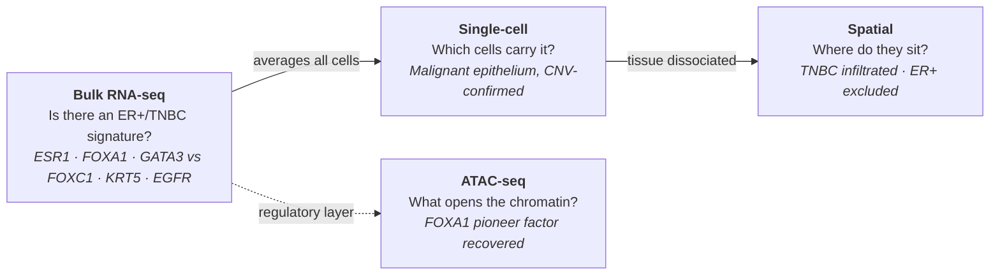

# Sathvik Sai Appagana

### Bioinformatics Analyst · Computational Biologist · MS Bioinformatics

*Cancer genomics and variant interpretation, built so every result can be checked against the simplest honest baseline.*

---

## About me

I'm a bioinformatician working across **cancer genomics** (bulk, single-cell, spatial, somatic variants) and **germline variant interpretation**. I build pipelines in **Nextflow** and **Snakemake**, containerize them with **Docker**, and run them on **HPC (SLURM)** and **AWS**.

The thing I care about most is the evaluation. A pipeline that runs isn't the same as a method that works. In most of my projects the deliverable is a benchmark: a negative control, a baseline the method has to beat, and numbers that are regenerated from the repo's own results rather than typed by hand.

<table>
<tr>
<td width="50%" valign="top">

**What I bring**
- End-to-end NGS analysis: FASTQ → alignment → calling/quantification → biology
- Bulk RNA-seq, scRNA-seq, spatial transcriptomics, ATAC-seq
- Somatic and germline variant calling (short- and long-read)
- ACMG/AMP classification and clinical knowledge bases
- Leakage-controlled ML benchmarking and statistics
- Relational data modelling and SQL performance work

</td>
<td width="50%" valign="top">

**How I work**
- Every claim gets a positive or negative control
- Baselines first: if a lookup table wins, I say so
- Negative results get reported, not tuned away
- Pinned environments, data-download scripts, fixed seeds
- Deviations from the original plan are written down
- READMEs say what the project *doesn't* show

</td>
</tr>
</table>

---

## At a glance

| | |
|---|---|
| **10** public projects | bulk · single-cell · spatial · epigenome · short- and long-read variants · clinical interpretation · ML · SQL |
| **31,265** single cells | annotated into 7 cell types, malignancy confirmed by inferCNV |
| **12,967** expert interpretations | ClinGen VCEP calls used to bound automated ACMG classification |
| **50-fold** nested CV | identical folds across clinical, XGBoost and neural-net relapse models |
| **25M-row** PostgreSQL database | 6 tables, 40 enforced constraints, 57 tests |
| **49.6×** matched coverage | ONT vs PacBio HiFi on HG002 against GIAB truth |

---

## Theme 1: Breast cancer at three resolutions

My core work is one connected story. Each project was built to answer the question the previous one couldn't.

| Project | What it shows | Stack |
|---|---|---|
| [**rnaseq-brca-pipeline**](https://github.com/pipelinepilot1999/rnaseq-brca-pipeline) | Bulk RNA-seq of 10 TNBC vs 10 ER+ tumors (GSE58135). Recovers the canonical signatures in the right direction (ESR1/FOXA1/GATA3 in ER+, FOXC1/KRT5/EGFR in TNBC), which validates the pipeline against known biology. | Snakemake · STAR · featureCounts · DESeq2 · clusterProfiler · AWS |
| [**scrna-tme-pipeline**](https://github.com/pipelinepilot1999/scrna-tme-pipeline) | 31,265 cells from 4 primary tumors (GSE161529). Places the subtype signature in the malignant epithelial compartment and confirms malignancy cell by cell through copy-number inference. TNBC is more genomically unstable than ER+. | Scanpy · Harmony · inferCNVpy |
| [**spatial-tme-pipeline**](https://github.com/pipelinepilot1999/spatial-tme-pipeline) | Reference-based deconvolution of 6 Visium sections, checked against pathologist annotation (RCTD vs SPOTlight r = 0.87–0.97 per section). Niche analysis shows the tumor–immune architecture differs by subtype: TNBC infiltrated, ER+ excluded. | RCTD · SPOTlight · squidpy · R ↔ Python |
| [**atac-seq-pipeline**](https://github.com/pipelinepilot1999/atac-seq-pipeline) | Open chromatin in MCF7 vs normal breast epithelium. 139,921 consensus peaks and 52,429 differential. An unbiased motif search independently recovers **FOXA1**, the ER+ pioneer factor, as a positive control. | Snakemake · bowtie2 · MACS2 · DESeq2 · HOMER · SLURM |

---

## 🔬 Theme 2: Measuring what methods actually add

These projects ask a harder question than "does the pipeline run?": **does the method deliver what it claims when compared against the simplest honest baseline?**

<table>
<tr>
<td width="50%" valign="top">

### [brca-multiomics-relapse-benchmark](https://github.com/pipelinepilot1999/brca-multiomics-relapse-benchmark)
**Does multi-omics beat clinical staging for breast cancer relapse? No.**

| Model (TCGA-BRCA, n=367) | AUC |
|---|---|
| Clinical only (age, stage, PAM50) | **0.779** |
| XGBoost, 19,338 omics features | 0.669 |
| Pathway-informed neural net | 0.613 |

All three run on identical 50-fold nested CV. A 7-block ablation shows methylation adds nothing over expression. A 9-gene panel with a frozen cutpoint still replicates in **METABRIC** (n=1,902; RR 1.95, p=1.2×10⁻⁵). Also includes a denoising multi-modal autoencoder.

`Nextflow DSL2` `Docker` `XGBoost` `SHAP`

</td>
<td width="50%" valign="top">

### [rare-disease-acmg-benchmark](https://github.com/pipelinepilot1999/rare-disease-acmg-benchmark)
**How much of automated variant interpretation is database lookup rather than reasoning?**

| Classifier vs ClinGen expert panels | Agreement |
|---|---|
| ClinVar lookup (reasons about nothing) | **97.5%** |
| Guideline-compliant ACMG/AMP engine | 36.4% |
| Ceiling for *any* automated classifier | 51.1% |

Every result is a paired informed-vs-blinded delta. Exomiser prioritization is run on real phenopacket cases injected into the GIAB trio. The ClinVar whitelist is worth +0.400 top-1, but only on the 29% of alleles it covers.

`Exomiser` `ACMG/AMP` `ClinVar` `ClinGen` `GIAB`

</td>
</tr>
<tr>
<td width="50%" valign="top">

### [civic-rag-eval](https://github.com/pipelinepilot1999/civic-rag-eval)
**RAG for somatic variant interpretation, with negative controls.**

Finding: **retrieval causes confabulation.** With no context, the model abstains on 100% of variants. With retrieved CIViC evidence, it invents a clinical significance for **22.7%** of plausible variants that have no CIViC record. Every citation it gave was valid, and none was appropriate.

A structured lookup beats embeddings on recall@1 (**0.960** vs 0.366). An always-abstain baseline stays in the results table to keep the metrics honest.

`RAG` `LLM evaluation` `CIViC` `hybrid retrieval`

</td>
<td width="50%" valign="top">

### [longread-platform-benchmark](https://github.com/pipelinepilot1999/longread-platform-benchmark)
**Oxford Nanopore vs PacBio HiFi on HG002 chr20, at matched 49.6× coverage.**

| Metric | ONT | HiFi |
|---|---|---|
| SV F1 (GIAB v5.0q) | 0.81 | 0.79 |
| Indel F1 | 0.75 | **0.87** |
| Phase blocks | **2.1 Mb** | 0.53 Mb |

ONT phased methylation recovers imprinting at known chr20 DMRs as a positive control. The one clear failure (L3MBTL1) is explained by a run of homozygosity.

`Nextflow DSL2` `minimap2` `Sniffles2` `Clair3` `WhatsHap` `modkit` `Truvari`

</td>
</tr>
</table>

---

## 🛠️ Theme 3: Pipelines & data engineering

| Project | Highlights | Stack |
|---|---|---|
| [**gatk-somatic-variant-calling**](https://github.com/pipelinepilot1999/gatk-somatic-variant-calling) | GATK4 Best Practices on real tumor–normal patient exomes (hg38). Separates inherited from tumor-acquired variants, and documents the debugging of real infrastructure failures (reference integrity, contig handling). | bwa-mem2 · BQSR · HaplotypeCaller · Mutect2 · Funcotator · maftools |
| [**tcga-brca-postgres**](https://github.com/pipelinepilot1999/tcga-brca-postgres) | Normalized PostgreSQL 16 database over TCGA-BRCA clinical, mutation and RNA-seq data (1,101 patients, 25M rows). A data-quality audit found that only **791 of 1,247** samples were exome-sequenced. With that denominator, TP53 moves from 21.2% to a published-range **33.4%**. `EXPLAIN ANALYZE` work cut one query from **574 → 6 ms**; three of five queries needed no index. | PostgreSQL · Python ETL · Docker · pytest |

> Every repo ships a pinned environment (conda or Docker), a data-download script, and a README whose numbers come from its own results.

---

## Toolkit

**Languages**

**Workflow & infrastructure**

| Area | Tools |
|---|---|
| **Single-cell & spatial** | Scanpy · Harmony · inferCNV · RCTD · SPOTlight · squidpy |
| **Bulk & epigenome** | STAR · featureCounts · DESeq2 · clusterProfiler · bowtie2 · MACS2 · HOMER · modkit |
| **Variants & long reads** | GATK4 · bwa-mem2 · Mutect2 · Funcotator · maftools · minimap2 · Sniffles2 · cuteSV · Truvari · Clair3 · WhatsHap · hap.py |
| **Clinical interpretation** | ACMG/AMP criteria · Exomiser · ClinVar · ClinGen · CIViC · gnomAD · HPO / phenopackets |
| **ML & statistics** | scikit-learn · XGBoost · SHAP · autoencoders · nested CV · permutation testing · Kaplan–Meier / log-rank |
| **Public data** | TCGA · METABRIC · GEO / SRA · ENCODE · GIAB · UCSC Xena |

---

**Open to Computational Biologist, Bioinformatics Analyst, Bioinformatics Engineer and Bioinformatics Scientist roles.**
Feel free to reach out at [sathvikappagana@gmail.com](mailto:sathvikappagana@gmail.com) or on [LinkedIn](https://linkedin.com/in/sathvik-appagana).

